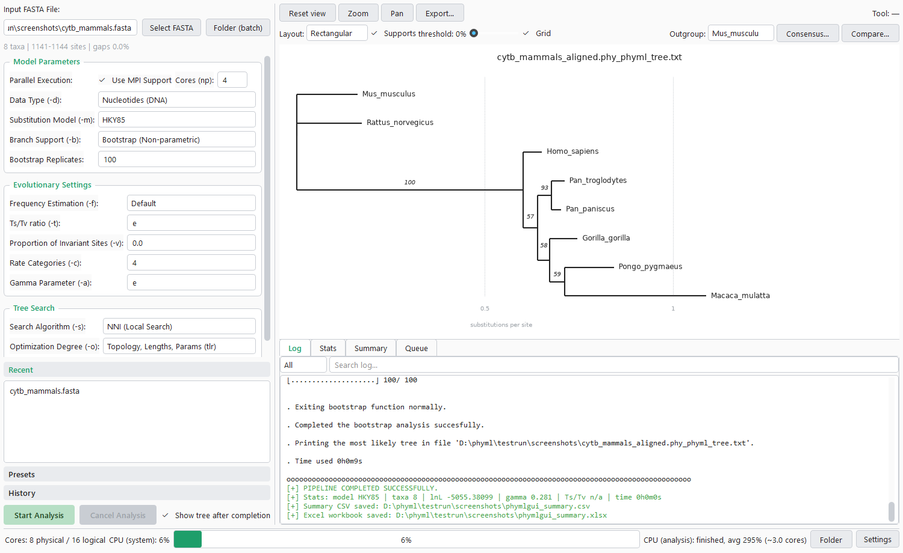
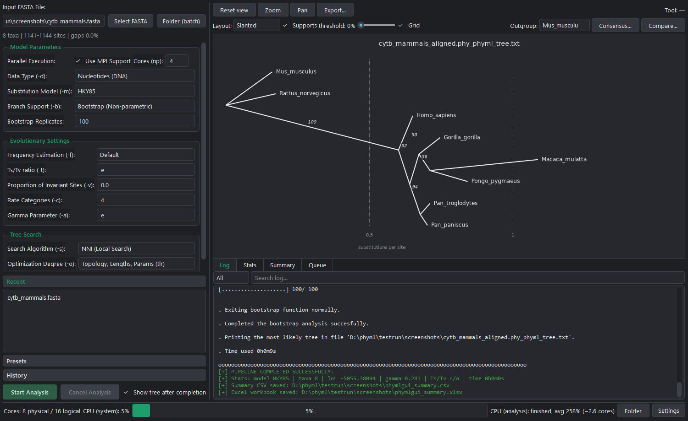
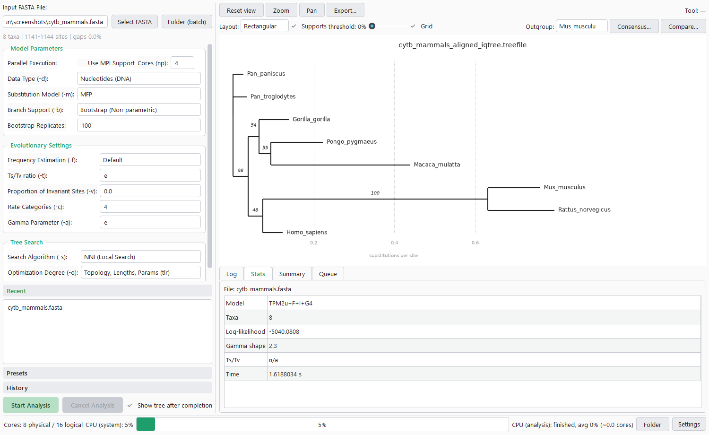

#  phymlGUI

English | [Русский](README.ru.md)

Open-source desktop tool for building maximum-likelihood phylogenetic trees from FASTA files. It aligns unaligned sequences with MUSCLE, runs **PhyML** (serial or MPI) or **IQ-TREE** (ModelFinder, ultrafast bootstrap) and shows the tree in an interactive viewer. Single files or whole folders, with a run history and parameter presets. Ready-to-run packages for Windows and Linux with all analysis programs included. English/Russian interface, dark and light themes.



## Features

### 1. Analysis pipeline
- **Two engines:** PhyML 3.3 (serial or parallel through MPI) and IQ-TREE 2 (automatic model selection with ModelFinder, ultrafast bootstrap), switchable in Settings.
- **Alignment on the fly:** unaligned FASTA is detected and aligned with MUSCLE before the analysis; aligned files go straight to the engine.
- **Input checks before the run:** IDs are cleaned and checked for collisions, FASTA is converted to relaxed PHYLIP, and invalid settings (a missing program, an MPI-only build without MPI, bad numbers) are listed together before anything starts.
- **Parallel computing:** MPI through `mpiexec` (Microsoft MPI, Windows) or `mpirun` (OpenMPI, Linux); the core count is pre-filled from the physical cores.
- **Live CPU monitor:** the status bar shows the system load and the load of the analysis process tree.
- **Safe cancel:** Cancel stops the whole process tree (`mpiexec` and every PhyML rank).

### 2. Tree viewer
- **Layouts:** rectangular, slanted and circular, with a distance grid and a scale in substitutions per site.
- **Supports:** bootstrap / aLRT / UFBoot values on branches, highlighting by a threshold.
- **Editing the view:** clade collapsing, rerooting on an outgroup, zoom and pan.
- **Comparison:** majority-rule consensus from bootstrap trees and Robinson–Foulds distance between two topologies.
- **Export:** PNG, SVG and PDF.



### 3. IQ-TREE with ModelFinder
- **Model selection:** `MFP` lets ModelFinder choose the substitution model; the chosen model, log-likelihood, gamma shape and run time appear in the Statistics tab.
- **Ultrafast bootstrap:** UFBoot supports on the tree; fewer than 1000 replicates (the UFBoot minimum) are raised to 1000 with a warning.



### 4. Batch mode, history and presets
- **Batch mode:** a whole folder of FASTA files in one run, with a live per-file queue, statuses, retry of the failed files and an N/M summary.
- **Reports:** `phymlgui_summary.csv` and `phymlgui_summary.xlsx` with the model, taxa, log-likelihood, gamma, Ts/Tv and run time of every file.
- **Run history:** every run is recorded with its parameters; a double click reopens its tree.
- **Presets:** built-in and user parameter presets, stored together with the engine.

### 5. Command line
The same pipeline without the window, for scripts and servers:

```bash
phymlgui-cli.exe --file data.fasta                  # Windows package
./phymlGUI-2.0.0-x86_64.AppImage --batch folder/    # Linux package
python phymlgui.py --file data.fasta --config preset.json
```

Settings come from the data folder; `--config` is a JSON object laid over them. Exit codes: `0` success, `1` a file failed or the run was cancelled, `2` a usage or input problem.

---

## Download

Ready-to-run packages are on the [Releases](https://github.com/adrobi/phymlGUI/releases) page; Python is not required.

- **Windows 10/11, 64-bit:** `phymlGUI-<version>-windows-x64.zip`. Unpack the whole archive and run `phymlgui.exe` (`phymlgui-cli.exe` for the command line). PhyML needs [Microsoft MPI](https://github.com/microsoft/Microsoft-MPI/releases) (`msmpisetup.exe`), also for serial runs: the bundled PhyML is an MPI build.
- **Linux x86_64:** `phymlGUI-<version>-x86_64.AppImage`. Run `chmod +x phymlGUI-*.AppImage` and start it; without FUSE add `--appimage-extract-and-run`. Built on Ubuntu 22.04 (glibc 2.35 or newer). MPI mode needs OpenMPI: `sudo apt install openmpi-bin`.
- **Checksums:** `SHA256SUMS`, verify with `sha256sum -c SHA256SUMS`.

Bundled programs (in `bin/`, licences in `licenses/`):

| Program | Windows | Linux |
| --- | --- | --- |
| [PhyML](https://github.com/stephaneguindon/phyml) | 3.3, MPI build | 3.3.20260528, serial and MPI builds |
| [IQ-TREE](https://github.com/iqtree/iqtree2) | 2.4.0 | 2.4.0 |
| [MUSCLE](https://github.com/rcedgar/muscle) | 5.3 | 5.3 |
| [RAxML-NG](https://github.com/amkozlov/raxml-ng) | 2.0.3, native build | 2.0.3 |

RAxML-NG is included for use from the command line; an engine for it in the window is planned. The Windows build is made from the official sources with a small patch; the sources and the patch are attached to every release (AGPL-3.0).

Settings and history are kept next to the program when that folder is writable, otherwise in `%APPDATA%\phymlGUI` (Windows) or `~/.config/phymlGUI` (Linux, `$XDG_CONFIG_HOME`). `PHYMLGUI_DATA_DIR` selects another folder.

## Installation & Quick Start (from source)

Requires **Python 3.11+** (**3.12+** on Linux: with 3.11 the interpreter aborts on exit, `bool_dealloc`, because of a reference-count bug in a C extension).

```bash
python -m venv .venv
source .venv/bin/activate          # Windows: .venv\Scripts\activate
pip install -r requirements.txt
python scripts/fetch_third_party.py --dest bin   # pinned, SHA256-verified programs
python phymlgui.py
```

Programs are looked up in `bin/` next to the app, then on `PATH`; paths can also be set in Settings.

Run the tests:

```bash
pip install -r requirements-dev.txt
python -m pytest
```

Tests that need a missing program are skipped; `PHYMLGUI_PHYML`, `PHYMLGUI_MPIEXEC`, `PHYMLGUI_IQTREE`, `PHYMLGUI_MUSCLE` and `PHYMLGUI_RAXML` point them to specific executables. The tests never touch your real settings. `scripts/make_screenshots.py` regenerates the screenshots from real runs.

## Output files

Next to each input file:

- `*_aligned.fasta`: the MUSCLE alignment (for unaligned input)
- `*.phy`: the relaxed PHYLIP passed to the engine
- `*_phyml_tree.txt`, `*_phyml_stats.txt`, `*_phyml_boot_trees.txt`: PhyML results
- `*.treefile`, `*.iqtree`, `*.log`: IQ-TREE results
- `phymlgui_summary.csv`, `phymlgui_summary.xlsx`: one row per file

## Citation

If you use phymlGUI in published work, please cite the programs that did the analysis:

- **PhyML:** Guindon S, Dufayard J-F, Lefort V, Anisimova M, Hordijk W, Gascuel O. New algorithms and methods to estimate maximum-likelihood phylogenies: assessing the performance of PhyML 3.0. *Systematic Biology* 59(3):307–321, 2010.
- **IQ-TREE 2:** Minh BQ, Schmidt HA, Chernomor O, et al. IQ-TREE 2: new models and efficient methods for phylogenetic inference in the genomic era. *Molecular Biology and Evolution* 37(5):1530–1534, 2020.
- **MUSCLE 5:** Edgar RC. Muscle5: high-accuracy alignment ensembles enable unbiased assessments of sequence homology and phylogeny. *Nature Communications* 13:6968, 2022.

## License

MIT License — Copyright (c) 2026 Aleksey Drobin ([@adrobi](https://github.com/adrobi)). The bundled programs keep their own licences: PhyML and MUSCLE GPL-3.0, IQ-TREE GPL-2.0, RAxML-NG AGPL-3.0 (see `licenses/` in the packages). Changes are listed in [CHANGELOG.md](CHANGELOG.md).
