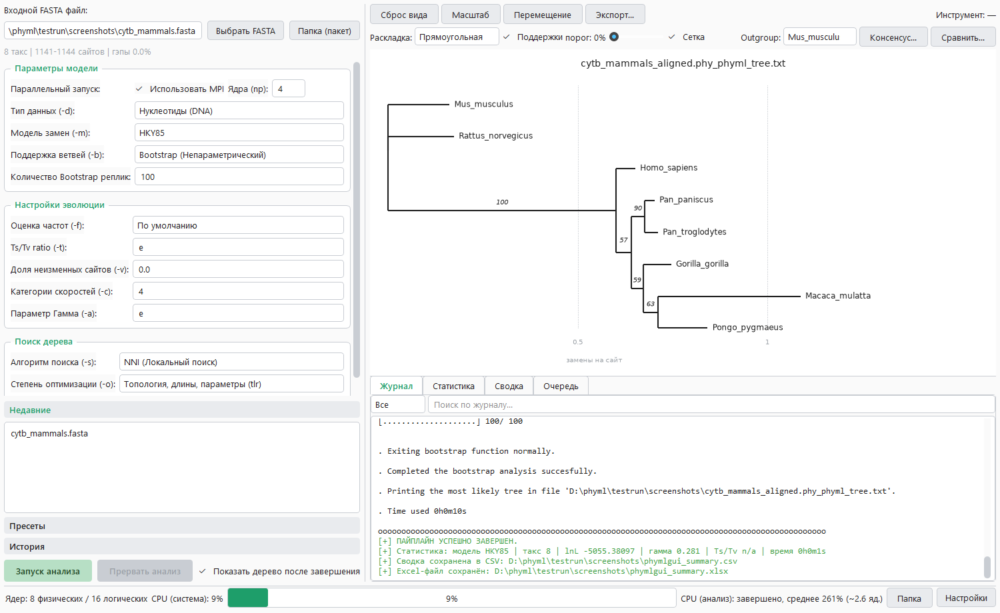
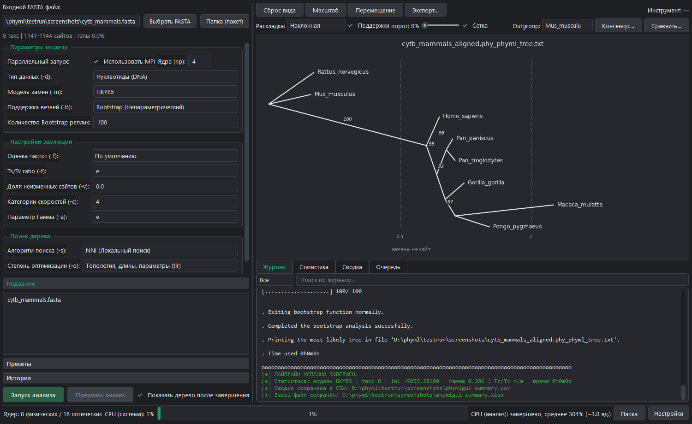
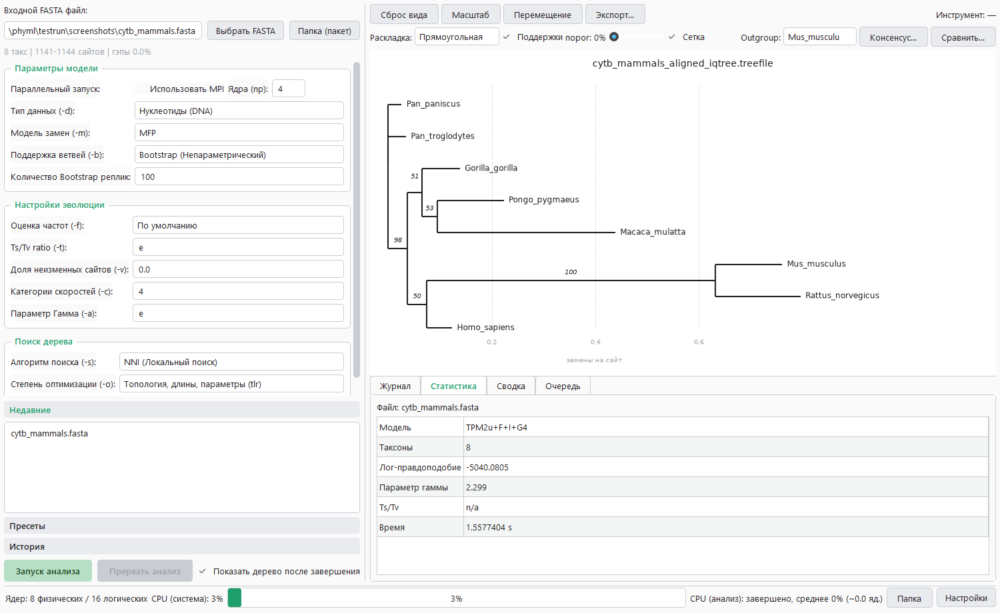

#  phymlGUI

[English](README.md) | Русский

Открытое десктопное приложение для построения филогенетических деревьев методом максимального правдоподобия по FASTA-файлам. Выравнивает невыровненные последовательности программой MUSCLE, запускает **PhyML** (последовательно или через MPI) или **IQ-TREE** (ModelFinder, ультрабыстрый бутстреп) и показывает дерево в интерактивном просмотрщике. Отдельные файлы или целые папки, история запусков и пресеты параметров. Готовые пакеты для Windows и Linux со всеми программами анализа внутри. Русский и английский интерфейс, тёмная и светлая темы.



## Возможности

### 1. Пайплайн анализа
- **Два движка:** PhyML 3.3 (последовательно или параллельно через MPI) и IQ-TREE 2 (автоподбор модели ModelFinder, ультрабыстрый бутстреп), переключение в настройках.
- **Выравнивание по ходу дела:** невыровненный FASTA распознаётся и выравнивается MUSCLE перед анализом; выровненные файлы сразу идут в движок.
- **Проверка до запуска:** ID очищаются и проверяются на совпадения, FASTA переводится в relaxed PHYLIP, а ошибки настроек (нет программы, MPI-сборка без MPI, неверные числа) показываются списком до старта.
- **Параллельные вычисления:** MPI через `mpiexec` (Microsoft MPI, Windows) или `mpirun` (OpenMPI, Linux); число ядер подставляется по физическим ядрам.
- **Монитор CPU:** в строке состояния видна загрузка системы и дерева процессов анализа.
- **Аккуратная отмена:** «Прервать» останавливает всё дерево процессов (`mpiexec` и каждый ранг PhyML).

### 2. Просмотрщик деревьев
- **Раскладки:** прямоугольная, наклонная и круговая, с сеткой расстояний и шкалой в заменах на сайт.
- **Поддержки:** значения bootstrap / aLRT / UFBoot на ветвях, подсветка по порогу.
- **Работа с видом:** сворачивание клад, укоренение по outgroup, масштаб и перемещение.
- **Сравнение:** консенсус большинства из бутстреп-деревьев и расстояние Робинсона–Фаулдса между двумя топологиями.
- **Экспорт:** PNG, SVG и PDF.



### 3. IQ-TREE с ModelFinder
- **Подбор модели:** `MFP` поручает выбор модели замен ModelFinder; выбранная модель, лог-правдоподобие, параметр гаммы и время работы показываются на вкладке «Статистика».
- **Ультрабыстрый бутстреп:** поддержки UFBoot на дереве; меньше 1000 реплик (минимум UFBoot) поднимается до 1000 с предупреждением.



### 4. Пакетный режим, история и пресеты
- **Пакетный режим:** целая папка FASTA-файлов за один запуск — живая очередь со статусами, повтор неудавшихся файлов и сводка N/M.
- **Отчёты:** `phymlgui_summary.csv` и `phymlgui_summary.xlsx` с моделью, числом таксонов, лог-правдоподобием, гаммой, Ts/Tv и временем по каждому файлу.
- **История запусков:** каждый запуск записывается вместе с параметрами; двойной клик открывает его дерево.
- **Пресеты:** встроенные и пользовательские пресеты параметров, сохраняются вместе с движком.

### 5. Командная строка
Тот же пайплайн без окна — для скриптов и серверов:

```bash
phymlgui-cli.exe --file data.fasta                  # пакет для Windows
./phymlGUI-2.0.0-x86_64.AppImage --batch folder/    # пакет для Linux
python phymlgui.py --file data.fasta --config preset.json
```

Настройки берутся из папки данных; `--config` — JSON-объект, накладываемый поверх них. Коды выхода: `0` — успех, `1` — файл не обработан или запуск отменён, `2` — ошибка аргументов или входных данных.

---

## Скачать

Готовые пакеты лежат на странице [Releases](https://github.com/adrobi/phymlGUI/releases); Python не нужен.

- **Windows 10/11, 64 бит:** `phymlGUI-<версия>-windows-x64.zip`. Распакуйте архив целиком и запустите `phymlgui.exe` (`phymlgui-cli.exe` — для командной строки). PhyML требует [Microsoft MPI](https://github.com/microsoft/Microsoft-MPI/releases) (`msmpisetup.exe`), в том числе для последовательного режима: встроенный PhyML собран с MPI.
- **Linux x86_64:** `phymlGUI-<версия>-x86_64.AppImage`. Выполните `chmod +x phymlGUI-*.AppImage` и запустите; без FUSE добавьте `--appimage-extract-and-run`. Собран на Ubuntu 22.04 (нужен glibc 2.35 или новее). Для MPI-режима нужен OpenMPI: `sudo apt install openmpi-bin`.
- **Контрольные суммы:** `SHA256SUMS`, проверка — `sha256sum -c SHA256SUMS`.

Программы в комплекте (в `bin/`, лицензии — в `licenses/`):

| Программа | Windows | Linux |
| --- | --- | --- |
| [PhyML](https://github.com/stephaneguindon/phyml) | 3.3, MPI-сборка | 3.3.20260528, последовательная и MPI-сборки |
| [IQ-TREE](https://github.com/iqtree/iqtree2) | 2.4.0 | 2.4.0 |
| [MUSCLE](https://github.com/rcedgar/muscle) | 5.3 | 5.3 |
| [RAxML-NG](https://github.com/amkozlov/raxml-ng) | 2.0.3, нативная сборка | 2.0.3 |

RAxML-NG входит в комплект для работы из командной строки; движок для него в окне программы запланирован. Сборка для Windows сделана из официальных исходников с небольшим патчем; исходники и патч прикладываются к каждому релизу (AGPL-3.0).

Настройки и история хранятся рядом с программой, если эта папка доступна для записи, иначе в `%APPDATA%\phymlGUI` (Windows) или `~/.config/phymlGUI` (Linux, `$XDG_CONFIG_HOME`). Другую папку задаёт переменная `PHYMLGUI_DATA_DIR`.

## Установка и быстрый старт (из исходников)

Нужен **Python 3.11+** (под Linux **3.12+**: с 3.11 интерпретатор аварийно завершается при выходе, `bool_dealloc`, из-за ошибки счётчика ссылок в C-расширении).

```bash
python -m venv .venv
source .venv/bin/activate          # Windows: .venv\Scripts\activate
pip install -r requirements.txt
python scripts/fetch_third_party.py --dest bin   # закреплённые программы с проверкой SHA256
python phymlgui.py
```

Программы ищутся в `bin/` рядом с приложением, затем в `PATH`; пути можно задать и в настройках.

Запуск тестов:

```bash
pip install -r requirements-dev.txt
python -m pytest
```

Тесты, которым нужна отсутствующая программа, пропускаются; переменные `PHYMLGUI_PHYML`, `PHYMLGUI_MPIEXEC`, `PHYMLGUI_IQTREE`, `PHYMLGUI_MUSCLE` и `PHYMLGUI_RAXML` указывают на конкретные исполняемые файлы. Тесты никогда не трогают ваши настоящие настройки. `scripts/make_screenshots.py` пересоздаёт скриншоты по настоящим запускам.

## Выходные файлы

Рядом с каждым входным файлом:

- `*_aligned.fasta` — выравнивание MUSCLE (для невыровненного входа)
- `*.phy` — relaxed PHYLIP, переданный движку
- `*_phyml_tree.txt`, `*_phyml_stats.txt`, `*_phyml_boot_trees.txt` — результаты PhyML
- `*.treefile`, `*.iqtree`, `*.log` — результаты IQ-TREE
- `phymlgui_summary.csv`, `phymlgui_summary.xlsx` — по строке на файл

## Цитирование

Если вы используете phymlGUI в публикации, пожалуйста, цитируйте программы, которые выполнили анализ:

- **PhyML:** Guindon S, Dufayard J-F, Lefort V, Anisimova M, Hordijk W, Gascuel O. New algorithms and methods to estimate maximum-likelihood phylogenies: assessing the performance of PhyML 3.0. *Systematic Biology* 59(3):307–321, 2010.
- **IQ-TREE 2:** Minh BQ, Schmidt HA, Chernomor O, et al. IQ-TREE 2: new models and efficient methods for phylogenetic inference in the genomic era. *Molecular Biology and Evolution* 37(5):1530–1534, 2020.
- **MUSCLE 5:** Edgar RC. Muscle5: high-accuracy alignment ensembles enable unbiased assessments of sequence homology and phylogeny. *Nature Communications* 13:6968, 2022.

## Лицензия

MIT License — Copyright (c) 2026 Aleksey Drobin ([@adrobi](https://github.com/adrobi)). Программы в комплекте распространяются по своим лицензиям: PhyML и MUSCLE — GPL-3.0, IQ-TREE — GPL-2.0, RAxML-NG — AGPL-3.0 (см. `licenses/` в пакетах). Изменения перечислены в [CHANGELOG.md](CHANGELOG.md).
